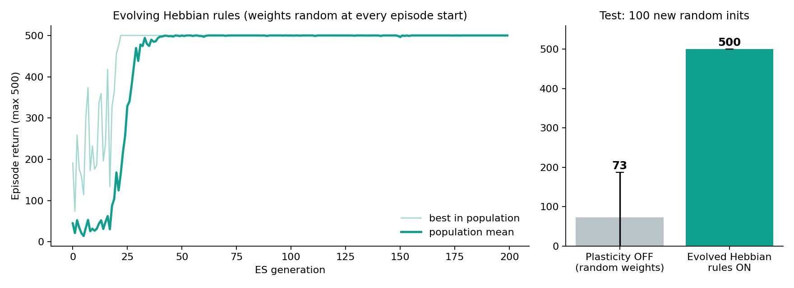

# Self-Organizing Synapses for Continual RL

**Can evolved Hebbian networks avoid loss of plasticity?**
Semester project for *Self-Organizing Systems* (2026–2027) — Cobzaru Mihai Andrei.

Deep RL agents trained on a changing stream of tasks gradually lose their ability to learn
(*loss of plasticity*, Dohare et al., Nature 2024). This project tests whether networks whose
weights **self-organize** through evolved, local Hebbian rules (Najarro & Risi, NeurIPS 2020)
keep adapting where gradient-trained agents (PPO, PPO + continual backprop) stall.

## How it works

- The network's weights are **not** trained. They start random at every episode and change at
  every step with a per-synapse rule: `dw_ij = eta * (A*o_i*o_j + B*o_j + C*o_i + D)`.
- An evolution strategy (OpenAI-ES via [evosax](https://github.com/RobertTLange/evosax)) searches
  the rule coefficients `A, B, C, D, eta`.
- Everything is written in [JAX](https://github.com/jax-ml/jax), so whole populations of agents
  run in parallel (`vmap` + `jit`).

## Status

| Stage | Status |
|---|---|
| Hebbian network + ES pipeline (CartPole pilot) | done |
| Non-stationary dynamics wrapper (friction / mass / joint failure) |  next |
| PPO and PPO + continual-backprop baselines | next |
| Reward-modulated Hebbian rule | next |
| Continual experiments on Brax tasks (Colab GPU) | next |

### Pilot result (CartPole-v1)

Rules evolved for 200 generations (population 128, ~70 s on a laptop CPU). Tested on 100 brand-new
random weight initialisations:

| Condition | Mean return (max 500) |
|---|---|
| Same random weights, plasticity off | 73.2 ± 114.1 |
| Evolved Hebbian rules on | **500.0 ± 0.0** |



## Setup

```bash
python -m venv .venv
# Windows PowerShell: .venv\Scripts\Activate.ps1   |   Linux/macOS/WSL: source .venv/bin/activate
pip install -r requirements.txt
```

On Windows this installs CPU-only JAX (fine for development). For GPU runs use Google Colab
(it ships JAX with GPU support; just `pip install gymnax evosax`) or WSL2 with `pip install -U "jax[cuda12]"`.

## Run the pilot

```bash
python -m scripts.pilot_cartpole --generations 200
python -m scripts.plot_pilot
```

## Repository layout

```
hcrl/            library code (Hebbian network, later: environments, baselines)
scripts/         experiment and plotting scripts
results/         logs, figures, evolved rules
```

## References

- Najarro, E., & Risi, S. (2020). Meta-learning through Hebbian plasticity in random networks. *NeurIPS 33*.
- Salimans, T., Ho, J., Chen, X., Sidor, S., & Sutskever, I. (2017). Evolution strategies as a scalable alternative to reinforcement learning. arXiv:1703.03864.
- Dohare, S., Hernandez-Garcia, J. F., Lan, Q., Rahman, P., Mahmood, A. R., & Sutton, R. S. (2024). Loss of plasticity in deep continual learning. *Nature, 632*, 768–774.
- Abbas, Z., Zhao, R., Modayil, J., White, A., & Machado, M. C. (2023). Loss of plasticity in continual deep reinforcement learning. *CoLLAs 2023*.
- Yuan, M., Wang, Q., Ma, G., et al. (2025). Plasticine: Accelerating research in plasticity-motivated deep reinforcement learning. arXiv:2504.17490.
